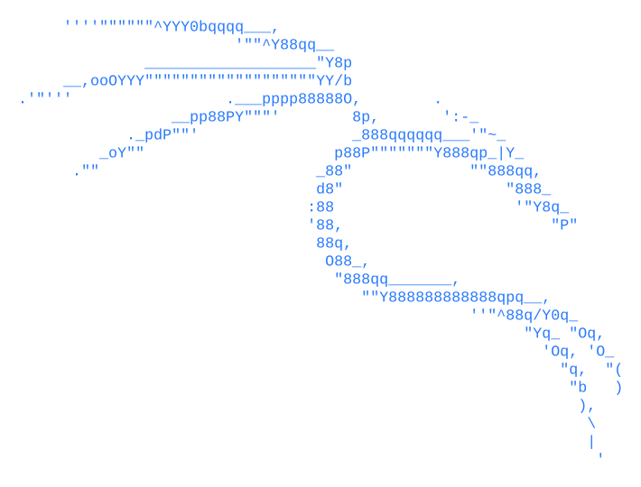

  

  <picture>
    <source media="(prefers-color-scheme: dark)" srcset="./kali.dark.svg">
    
  </picture>

Kali ASCII art from <a href="https://ascii.rest/kali-linux/">ascii.rest</a> (MIT, see <a href="./kali.LICENSE">kali.LICENSE</a>).
